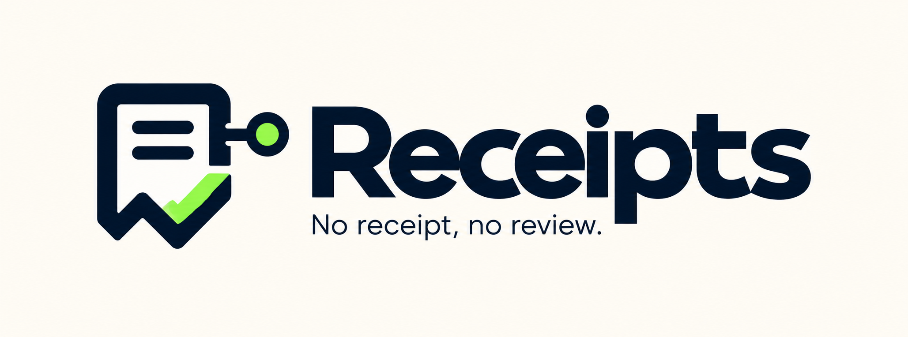

# Receipts



Verified, voice-first reviews of anything you bought. Every review is tied to a cryptographic proof of purchase,
written by a verified unique human, structured from a 15-second voice note, and anchored on Base. AI agents pay a
fraction of a cent in USDC (x402) to query them; the reviewers they cite get paid.

## Run it

Needs Node 22+ and pnpm 12. Nothing else: with an empty `.env` everything runs locally (PGlite database, an
in-memory EVM, simulated purchases and mock humans, all labelled as such).

```bash
pnpm install
pnpm dev          # API :8787, reviewer web app :3000 (business app at :3000/business), stage :3002/stage, admin :3003/admin
```

| Command | What it does |
|---|---|
| `pnpm dev:api` | API alone (runs the cron jobs in-process in development) |
| `pnpm e2e` | End-to-end over HTTP against a running API: sign-in, mock human, proof, card, publish, verify, ask, MCP, attack |
| `pnpm agent "best veg biryani under ₹400 near Calangute"` | The split-screen demo in a terminal: an agent on a poisoned sandbox web vs the same agent on Receipts |
| `pnpm dev:mobile` | The Expo app (Expo Go, SDK 58). The phone must be on the same Wi-Fi; the API address is derived from the dev server |
| `pnpm test` | Unit and integration tests (core, categories, brands, contracts, db, rails, engine, agent) |
| `pnpm typecheck` | Every package and app |
| `pnpm test:e2e` | Browser tests (Playwright, in the installed Microsoft Edge) of the web apps on desktop and phone: every page, the first-visit splash, the full reviewer journey, the answer flow, Privy sign-in, the business sign-in and claim search, a business claim approved in the admin console, the stage. Runs its own stack on ports 3100-3103 and 8799 (in-memory chain and database), so `pnpm dev` can keep running; report in `e2e/report` |
| `pnpm contracts:build` / `contracts:test` / `contracts:deploy` | solc-js build, tests on an in-memory EVM, deploy to Base Sepolia (`-- --skip-governance` for the core contracts only) |
| `pnpm graph:setup` | Set up a TigerGraph Savanna workspace from `TIGERGRAPH_API_KEY`: database user, schema, queries, secret |
| `pnpm graph:wake` | Resume the Savanna workspace (it pauses after an idle hour, and stays paused while its auto start is off); run it before a demo |
| `pnpm rehearse` | Before the demo: the API's keys, the wallets' gas and the agent's USDC, TigerGraph, and the stage's three answers warmed; lists what to fix. `REHEARSE_API_URL=https://<domain>` checks a deployment. Reads only |
| `pnpm --filter @receipts/worker once` | Run every job once (follow-ups, trust, graph sync, epoch, cashback, audio cleanup) |
| `pnpm safe install` / `pnpm safe add <pkg>` | Install through Socket Firewall, which blocks known-malicious packages (no account needed) |
| `pnpm security:scan` | A full Socket scan of every manifest (reads `SOCKET_CLI_API_TOKEN` from `.env`; a free socket.dev account) |

This machine's shell sets `NODE_ENV=development`, which breaks `next build`; the app build scripts already run
under `cross-env NODE_ENV=production`.

Copy `.env.example` to `.env` to turn integrations on. The API logs which ones are live at startup; see
[docs/prep-checklist.md](docs/prep-checklist.md) for the accounts and keys.

## How it fits together

```
apps/
  api        Hono API: proof rails, reviews, identity, payouts, merchants, webhooks, x402 endpoints, MCP at /mcp
  worker     Cron jobs for production (development runs them inside the API)
  web        Reviewer PWA (Next.js 16): ask, prove, record, sign, receipts, earnings, check-ins, badge, scan, and
             /poster, the printable seeding poster
  merchant   Business dashboard: claim, insights, public replies, signed QR receipts, badge, plan. A zone of the
             web app: served at /business on its origin (own server :3001), so one account and one sign-in
  demo       Stage: two agents side by side, the review-ring attack, the week in numbers with a labelled Settle now
             (the nightly payout epoch, run at once), the sandbox pages
  admin      Operator console: business claims, held reviews and trust flags, attestations waiting to anchor, providers
  mcp        Receipts MCP over stdio, an x402 paying bridge for MCP clients that cannot pay, the agent CLI
  mobile     Expo app (Android and iOS): the reviewer flow on a phone
packages/
  core       Schemas, nullifiers, EAS encoders, scoring math, citation validator, CIDs
  rails      The seven proof rails, each ending in one PurchaseClaim
  brands     Brands and the rails each supports; email parsers
  categories Eight categories as YAML config (follow-ups, publish rules, aspects, prompts)
  db         Postgres schema and migrations (PGlite in development), seeds (places come from Google Maps)
  contracts  PersonhoodRegistry, ReceiptsResolver (EAS), PayoutDistributor, ReceiptsReputation, testnet governance
  engine     The backend: identity, proofs, structuring, reviews, follow-ups, query, trust, payouts, shop, merchants
  client     Typed API client for the web, merchant and mobile apps
  react      Wallet, session and UI kit shared by the three web apps
  agent      The demo agents (baseline on the sandboxed web, Receipts agent paying over x402)
infra/       Postgres with PostGIS and pgvector; optional TigerGraph Community Edition
```

The loop: a purchase is proven on any rail (order page via Reclaim, order email via DKIM or ZK Email, payment
proof, shop-through postback, a merchant-signed QR receipt, an on-chain payment, an ONDC order) and stored once,
guarded by a nullifier. The reviewer, verified once as a unique human (Self or Anon Aadhaar), talks for 15
seconds; Sarvam transcribes, a model structures the card against the category's schema, and the reviewer edits and
signs it. The review is attested on Base through EAS (the reviewer signs, Receipts pays gas). Follow-ups ask "still
good?" later. The trust engine scores reviewers by how well their ratings match later consensus, weights reviews
by that track record, and flags rings, shared funders and bursts; an investigator agent writes the case file and a
person decides. Agents query over MCP or HTTPS and pay per call; 70% goes to the reviewers the answer cited, settled
in daily Merkle epochs on the PayoutDistributor and claimable gaslessly, or withdrawn to UPI.

## Agents

```bash
claude mcp add --transport http receipts http://localhost:8787/mcp              # direct (x402-capable clients pay)
claude mcp add receipts -- pnpm --dir <repo>/apps/mcp stdio                     # local engine, paid tools free
RECEIPTS_API_URL=https://... AGENT_PRIVATE_KEY=0x... pnpm --dir apps/mcp bridge   # pays from your wallet
```

Paid: `search_receipts` ($0.005), `get_item_reputation` and `get_merchant_reputation` ($0.002). Free:
`get_receipt`, `verify_receipt`, `get_shop_link`, `coverage`. HTTPS: `GET /v1/answer?q=...` answers 402 until paid.

## Honest status

Verified here: all packages typecheck; the test suites pass; the HTTP end-to-end run passes, locally and against
Base Sepolia; the three Next.js apps build; the Expo app bundles for Android; the stage route streams both agents;
the attack moves a plain average from 2.27 to 3.13 while the trust score moves 3.45 to 3.54 and the ring is flagged.

With real accounts (October 2026): the contracts are deployed on Base Sepolia (`packages/contracts/deployments`), and
a review published over HTTP is attested there and verifies; Sarvam transcribes a spoken review (saaras:v3 and v4);
reviews pin to IPFS through Pinata under the same CID we compute; Reclaim starts proof sessions for community
Swiggy, Zomato and Amazon providers; Razorpay test mode creates the ₹1 merchant link; TigerGraph Savanna issues
tokens from the API's secret; OpenAI's gpt-5-nano (an AI Grants India key) writes review cards and cited answers and
runs both demo agents, as Gemini did before it; Smallest AI reads published reviews and answers aloud.

Not exercised yet: a real Reclaim proof end to end (the callback needs the API on a public URL), ZK Email
blueprints, Self and Anon Aadhaar in production mode, Claude, x402 settlement (the agent wallet needs test USDC),
RazorpayX payouts, Dodo, the TigerGraph sync (waits on the schema grant), push notifications. Each has a labelled
fallback so the product still runs. Self now calls
its open-source SDK legacy (no shutdown date given); Anon Aadhaar is the alternative.
